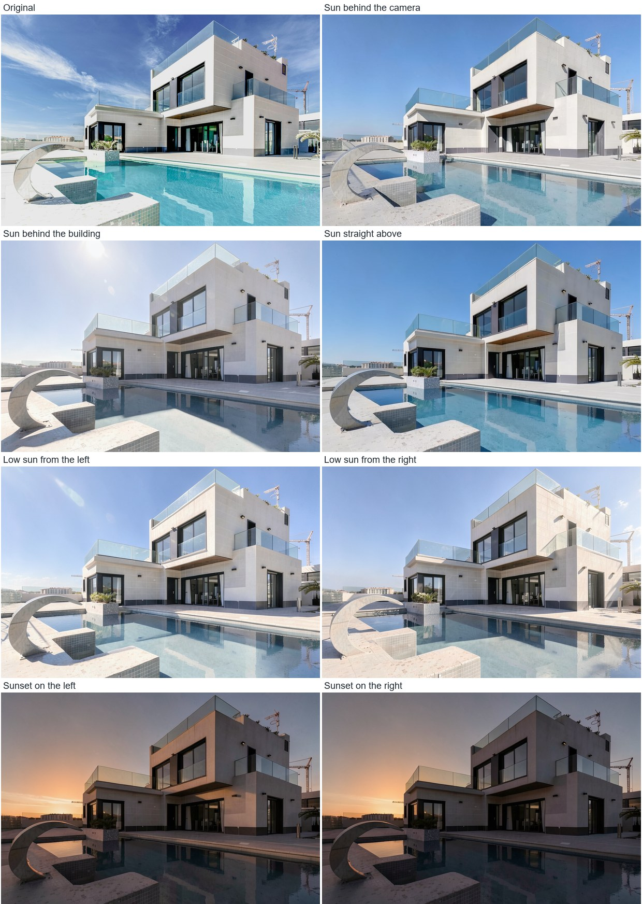
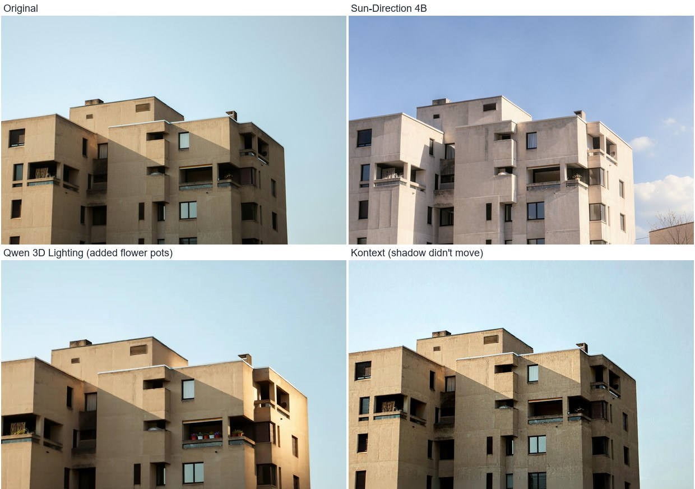
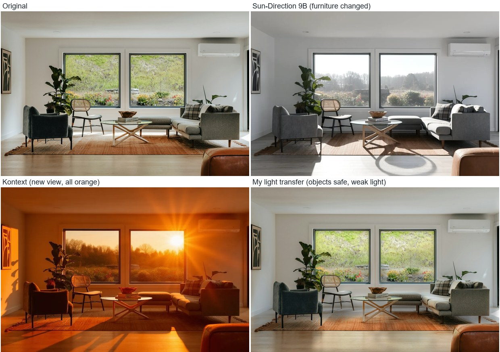

# Moving the sun in architecture photos

Can you change where the sun comes from in a photo without messing up the building?

This was a task from MyArchitectAI. I tried a few AI tools on three real photos, kept all the results (the bad ones too) and wrote down what happened.

**Short answer:** it works pretty well on exteriors, not on interiors yet. Full write-up is in the [PDF report](Mehmet_Ozturk_sun_direction_report.pdf).

## Same villa, different sun

Made with the Sun-Direction LoRA running on my own RTX 4070.



Not perfect though. The steel sculpture starts to look like stone, the pool loses some color, and when I asked for a sunset on the right the orange sky stayed on the left.

## Tools side by side

I asked all of them to move the sun to the right on this building.



- **Sun-Direction LoRA:** the only one that really moves the sun, but it changes some materials and adds things like trees.
- **Qwen 3D Lighting:** fast and keeps the colors, but it zooms the picture, leaves old shadows and added flower pots.
- **FLUX Kontext:** keeps the building, but the shadow doesn't move.

## Interiors are the hard part



Every tool broke something here. The sofa color, table and rug size changed, or the view out of the window was replaced. So I also wrote a small script that copies only the light onto the original photo. The furniture stays safe, but the light change is weak and old hard shadows don't go away.

## What's in here

| Path | What it is |
|---|---|
| `Mehmet_Ozturk_sun_direction_report.pdf` | The report |
| `photos/` | The three original photos and credits |
| `results/` | Every result, including failures, sorted by tool |
| `results/timings.csv` | How long each run took |
| `results/_report/` | Side by side comparisons and scores |
| `run_space.py` | Sends a photo to a free Hugging Face Space |
| `run_local.py` | Runs Sun-Direction 4B on your own GPU |
| `light_transfer.py` | Copies only the light onto the original |
| `compare.py` | Compares results with the original |
| `build_pdf.py`, `make_samples.py` | Build the report and the images above |

## Try it

```bash
pip install -r requirements.txt
hf auth login
```

Send a photo to a free Space:

```bash
python run_space.py sun_direction photos/03_concrete_block.jpg right --sun 90 --height 30
```

Or run it on your own GPU. You need PyTorch with CUDA, about 16 GB of disk and a 12 GB card. It took me about 75 to 115 seconds per image on an RTX 4070.

```bash
python run_local.py --only villa_angles
```

Then compare the results:

```bash
python compare.py
```

## What I'd do next

- Test on a lot more photos, since three isn't many
- Lock glass, metal and water with masks
- Use a depth map to work out real shadows
- Train or find a LoRA for interiors

Photos are from Unsplash, credits are in [photos/CREDITS.md](photos/CREDITS.md).
